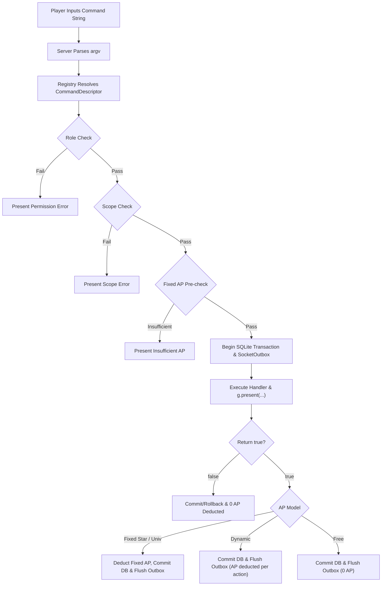
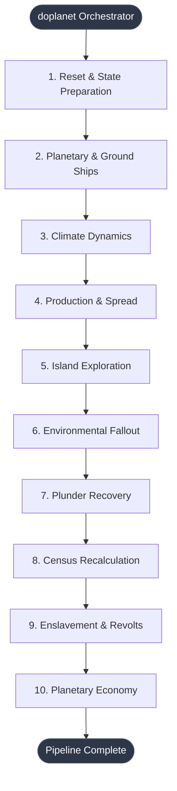
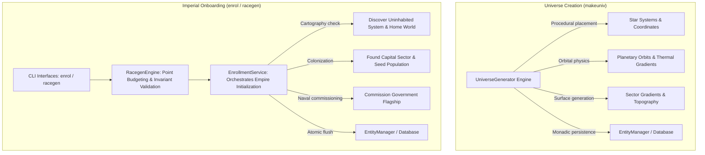
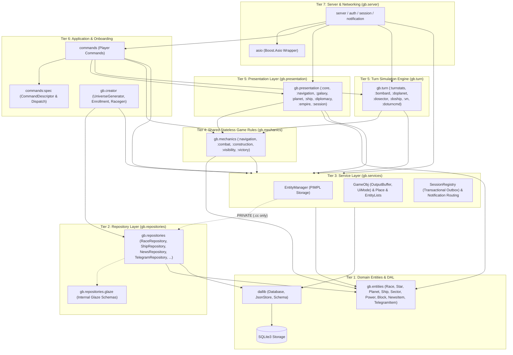

# Galactic Bloodshed Architecture

## Overview

Galactic Bloodshed uses a clean **n-tier architecture** with clear separation of concerns. Each layer has a single responsibility and communicates only with adjacent layers through well-defined interfaces.

The current implementation is centered on a repository-backed `EntityManager` service rather than a generic `GameDataService`. That is intentional: the codebase needs a pragmatic persistence boundary for game entities, not a large abstraction framework.

## Persistence API Guarantees

These are the architectural guarantees the project is converging toward. Some are already true in code today; the remaining cleanup work is tracked in [plan-database.md](plan-database.md).

1. **SQLite details stay in the DAL.** Raw `sqlite3_*` calls, pragmas, SQL statements, and connection lifecycle belong in `dallib` only.
2. **Repositories own serialization and table-specific persistence.** A repository may know how a `Race`, `Ship`, or `Planet` maps to storage, but it must not contain game rules.
3. **EntityManager is the game-facing persistence interface.** Commands and core game logic should load, cache, iterate, mutate, and flush entities through `EntityManager` rather than talking to repositories directly.
4. **Writable access is monadic and scoped.** `mutate_*()` executes mutations inside a scoped lambda and automatically persists changes upon lambda completion. Internal `get_*()` handles are private to `EntityManager` to prevent handle lifetime errors.
5. **Read-only access is explicit.** `peek_*()`, `with_*()`, and readonly iterators (`RaceList::readonly`, `StarList::readonly`, etc.) exist so callers can traverse and inspect state without paying writable-handle overhead or implying mutation.
6. **Lookup semantics are consistent.** The target API is that entity lookup failures are treated as service-layer errors, with user-input paths translating those errors into clear command output.
7. **Iteration semantics are consistent.** Read-only loops use explicit readonly patterns (`XxxList::readonly`); mutable loops use handle-based iterators or scoped monadic mutations.
8. **Relational integrity and fail-fast persistence.** Database connections run with `PRAGMA foreign_keys = ON`. `JsonStore` updates existing rows in-place (`INSERT INTO ... ON CONFLICT(...) DO UPDATE SET data = excluded.data`) rather than using `REPLACE INTO` (`DELETE` + `INSERT`), preserving parent rows referenced by child foreign keys. Parent rows (`Star`, `Planet`, `Race`) are always persisted before child rows (`Planet`, `Sector`, `Ship`), and any `SqliteError` (`SQLITE_CONSTRAINT_FOREIGNKEY`, `SQLITE_CONSTRAINT_CHECK`) or `EntityNotFoundError` propagates immediately without defensive `try`/`catch` silencing.

## Layer Responsibilities

### Data Access Layer
- Owns SQLite connections, pragmas, transactions, schema creation, and SQL execution.
- Must not know game rules or command behavior.

### Repository Layer
- Owns entity-specific persistence, serialization, deserialization, and storage keys.
- May expose entity-specific queries, but not game-policy decisions.

### Service Layer
- Owns entity identity, caching, lifecycle management, persistence orchestration, and multi-entity game operations.
- Is the layer that should present a stable, game-friendly API to commands and turn processing.

### Application Layer
- Owns parsing, validation of user input, command-scoped error handling, and user-visible output.
- Must not talk to DAL or repository types directly.

## Architecture Layers

```
┌─────────────────────────────────────────────────────────┐
│                  Application Layer                       │
│              (Commands - User Interface)                 │
│                  gb/commands/*.cc                        │
└────────────────────┬────────────────────────────────────┘
                     │
                     ↓
┌─────────────────────────────────────────────────────────┐
│                   Service Layer                          │
│              (Business Logic & Coordination)             │
│                 gb/services/*.cc                         │
└────────────────────┬────────────────────────────────────┘
                     │
                     ↓
┌─────────────────────────────────────────────────────────┐
│                  Repository Layer                        │
│          (Type-Safe Data Access & Serialization)         │
│                gb/repositories/*.cc                      │
└────────────────────┬────────────────────────────────────┘
                     │
                     ↓
┌─────────────────────────────────────────────────────────┐
│              Data Access Layer (DAL)                     │
│            (Database Operations & Storage)               │
│                   gb/dal/*.cc                            │
└─────────────────────────────────────────────────────────┘
                     │
                     ↓
                 SQLite Database
```

## Subsystem Modules & Cross-Cutting Concerns

Galactic Bloodshed uses **C++26 modules** to enforce architectural boundaries. Subsystems are organized into distinct, modular libraries in `gb/`:

### Core Subsystem Modules (7-Tier Module DAG)

- **Tier 1: `gb.entities`** (Domain Model) - `gb/entities/entities.cppm` (`gb_entities` target)
  - Pure in-memory domain entities (`Race`, `Star`, `Planet`, `Ship`, `Sector`, `SectorMap`, `Universe`, `Commod`, `Power`, `Block`, `NewsItem`, `TelegramItem`, `ServerState`, `ShipExam`) with zero database, Glaze, or service dependencies
  - Polymorphic specialized ship hierarchy (`gb/entities/ship/`) with compile-time checked downcasting via `Ship::as<T>()`, `ShipFactory` deserialization, and encapsulated typed members (eliminating raw variant unpacking):
    - Base: `Ship` (`ship_base.cppm`)
    - Autonomous / Replicating: `AutonomousShip` $\to$ (`VonNeumannShip`, `BerserkerShip`) (`ship_subclasses.cppm`)
    - Directed Energy & Optics: `SpaceMirrorShip` (space mirrors, orbital/ground telescopes, tractor beams)
    - Biological / Spores: `SporePodShip` (thermal germination and orbital decay)
    - Atmospheric Alteration: `CanisterShip` (cooling dust canisters, greenhouse gas canisters)
    - Ballistic Ordnance: `MissileShip` (precision planetary coordinates and scatter impacts)
    - Orbital Hazards: `MineShip` (proximity trigger radii and radiative warheads)
    - Geoengineering: `TerraformerShip` $\to$ `GroundPlowShip` (surface order queues and plowing)
    - Cargo Transfer: `TransporterShip` (target recipient vessels)
    - Ecological Containment: `ToxicWasteShip` (planetary toxin harvesting and storage)
  - Type-safe IDs (`player_t`, `governor_t`, `shipnum_t`, `starnum_t`, `planetnum_t`, `commodnum_t`, `news_id_t`, `telegram_id_t` — all entity and governor primary keys are uniformly 1-based `>= 1`, while sector `(x, y)` coordinates remain 0-based), semantic metric aliases (`armor_t`, `damage_t`, `speed_t`, `radiation_t`, `fuel_t`, `gun_count_t`, `bearing_t`, `hangar_t`, `ship_size_t`, `weapon_power_t`, `resource_t`, `money_t`, `population_t`, `ap_t`), sparse `std::flat_map` / `std::flat_set` per-player and per-governor containers, `Coordinates`
  - First-class domain methods and computed predicates (`Ship::is_docked()`, `Ship::refuel_from_gas_giant()`, `Ship::process_radiation()`, `Ship::prepare_for_flight()`, `Planet::update_toxicity()`, `Planet::process_toxic_environmental_damage()`, `Planet::select_victim_to_steal_from()`, `SectorMap::process_supernova_devastation()`, `AutonomousShip::mine_sector()`, `AutonomousShip::roam_to_adjacent_sector()`)
  - Configuration constants (`Tweakables`), random utilities (`rand.cppm`), ship templates (`ship_templates.cppm`), and ship filters (`shipfilter.cppm`)

- **Tier 1: `dallib`** (Data Access Layer) - `gb/dal/dallib.cppm` (`dallib` target)
  - `Database`, `JsonStore`, and `initialize_schema()`
  - Only layer with direct dependency on SQLite3

- **Tier 2: `gb.repositories`** (Repository Pattern) - `gb/repositories/repositories.cppm` (`gb_repositories` target)
  - Persistence mapping layer between `EntityManager` and `dallib`
  - Specific `Repository<T>` adapters for races, ships, planets, stars, sectors, commodities, power, blocks, news, telegrams, universe, server state, and ship examination logs
  - `gb.repositories` exports zero Glaze headers; `glz::meta<T>` schemas are isolated inside `gb.repositories.glaze` (`gb/repositories/glaze_schemas.cppm`) and `.cc` implementation units

- **Tier 3: `gb.services`** (Service Layer) - `gb/services/services.cppm` (`gb_services` target)
  - `EntityManager`: Central entity lifecycle, caching, and monadic transaction coordinator (`entity_manager.cppm`), using `struct EntityManager::Storage` PIMPL so `gb.repositories` is never exported in `gb.services`'s public interface
  - `GameObj`: Per-command execution context, `UiMode` (`ASCII` or `JSON`), zero-locale `OutputBuffer` (`g.out`, `g.present()`, `g.print()`), `check_commandable(const Ship&)`, and AP deduction helpers (`gameobj.cppm`)
  - `Place`: Hierarchical scope path parser and formatter (`place.cppm`)
  - `RaceList`, `StarList`, `PlanetList`, `ShipList`, `CommodList`, `BlockList`: RAII and readonly collection views (`entitylists.cppm`)
  - `SessionRegistry` (with transactional `SocketOutbox` staging live cross-player messages until `EntityManager::Transaction::commit()`) & Notification routing (`session_registry.cppm`, `notification.cppm`, `tele.cppm`, `prompt.cppm`)

- **Tier 4: `gb.mechanics` & `gb.presentation`** (Shared Game Rules & Dual-Mode Presentation)
  - **`gb.mechanics`** (`gb/mechanics/mechanics.cppm`, `gb_mechanics` target): Multi-entity stateless rules returning structured domain results without formatting strings or touching player output:
    - `:navigation`: `moveship`, `do_merchant`, `followable`, `msg_OOF`, `autonav`, `dock`, `land`, `launch`, `fuel`, `order`, `load`/`unload` cargo transfers
    - `:combat`: `shoot_ship_to_ship`, `shoot_planet_to_ship`, `shoot_ship_to_planet`, `execute_ship_boarding`, `execute_landed_ship_boarding`, `execute_sector_ground_assault`, `execute_afv_walk`, `domine`, `trigger_mine`
    - `:construction`: `can_build_at_planet`, `can_build_on_ship`, `create_new_ship`, `configure_factory_blueprint`, `modify_factory_attribute`, `upgrade_single_ship`
    - `:visibility`: `in_range`, `can_see_ship`, `optical_range`, `ships_at_star`, `get4args`
    - `:victory`: `create_victory_list`, `compute_power_blocks`
  - **`gb.presentation`** (`gb/presentation/presentation.cppm`, `gb_presentation` target): Dual-mode (`UiMode::ASCII` via `std::format`/`tabulate` and `UiMode::JSON` via `glaze`) view models, result renderers, and telegram/news bulletin formatters:
    - `gb.presentation.core`: `UiMode`, `OutputBuffer`, `present_to`, `to_json_envelope`, ANSI color/inverse terminal helpers
    - `gb.presentation.planet_views`: Planetary maps (`map`), orbital maps (`orbit`), surveys, sector analysis, production, routes, and planetary turn bulletins
    - `gb.presentation.navigation`: Navigation reports, course/order results, docking/landing/launching, cargo transfer summaries, and scope changes
    - `gb.presentation.construction`: Ship construction, factory blueprints (`make`/`modify`), and in-service retrofits (`upgrade`)
    - `gb.presentation.ship_ops`: Ship rosters (`report`, `ship`, `stats`, `stock`, `weapons`, `factories`), crystal mounting, jettison, and scrapping
    - `gb.presentation.combat`: Tactical sweeps, ship/planet gunnery, boarding/ground combat reports, mine detonations, and combat/autonomous turn bulletins
    - `gb.presentation.empire_views`: Power/block standings, colonies, governors, market (`bid`/`sell`), diplomacy, communications (`read`/`send`/`post`), and victory announcements
    - `gb.presentation.production`: Stockpile and production summaries

- **Tier 5: `gb.turn`** (Turn Simulation Engine) - `gb/turn/turn.cppm` (`gb_turn` target)
  - Multi-pass simulation pipeline (`:turnstats`, `:bombard`, `:doplanet`, `:dosector`, `:doship`, `:vn`, `:doturncmd`), delegating all bulletin formatting to `gb.presentation` (zero `std::stringstream` or `tabulate` imports)

- **Tier 6: `commands` & `gb.creator`** (Application & Onboarding Layers)
  - **`commands`** (`gb/commands/commands.cppm`): Individual player command implementations authored with declarative `CommandDescriptor`s (`command_spec.cppm`), delegating domain rules to `gb.mechanics` and rendering all output through `g.present(...)` (`gb.presentation`)
  - **`gb.creator`** (`gb/creator/creator.cppm`): Procedural galaxy generation (`UniverseGenerator`), player registration (`EnrollmentService`), and 1400-point species design (`RacegenEngine`, `RaceArchetype`)

- **Tier 7: `gb.server`** (Server & Networking) - `gb/server/server_module.cppm` (`gb_server` target)
  - Asio-backed TCP server (`Server`), client sessions (`Session` with Telnet `IAC`/`TTYPE` terminal negotiation), authentication (`auth`), notifications (`notification`), and startup configuration (`server_config`)

### Strict 3-Tier Domain Logic Placement Rule

Every game function must reside in the lowest tier capable of expressing its inputs:
1. **`gb.entities` (`gb/entities/`)**: Pure in-memory operations on a single entity or small value set (`Planet`, `SectorMap`, `Sector`, `Ship`, `Race`) that do **not** touch `EntityManager`, `TurnStats`, or `push_telegram`. Single-entity logic is exposed as member methods (e.g., `Planet::update_toxicity()`, `Ship::refuel_from_gas_giant()`, `AutonomousShip::mine_sector()`) without redundant C-style free function wrappers.
2. **`gb.mechanics` (`gb/mechanics/`)**: Multi-entity domain operations requiring `EntityManager` or `SessionRegistry` that are invoked by both interactive player commands and turn processing (e.g., `moveship`, `shoot_ship_to_ship`, `compute_power_blocks`), returning structured domain result records.
3. **`gb.turn` (`gb/turn/`)**: Turn-only batch passes that orchestrate `EntityManager` iterations, accumulate `TurnStats`, and dispatch turn-end telegram bulletins via `gb.presentation` (`doplanet`, `dosector`, `doship`, `do_VN`, `doturncmd`).

### Module Dependencies (Strict Acyclic DAG)

```
gb.server       --> commands, gb.turn, gb.presentation, gb.mechanics, gb.services, gb.entities, dallib, asio
commands        --> gb.turn, gb.presentation, gb.mechanics, gb.services, gb.entities, scnlib
gb.creator      --> gb.services, gb.repositories, gb.entities, dallib, tabulate
gb.turn         --> gb.presentation, gb.mechanics, gb.services, gb.entities, dallib
gb.presentation --> gb.mechanics, gb.services, gb.entities, tabulate, glaze
gb.mechanics    --> gb.services, gb.entities, scnlib
gb.services     --> PUBLIC: gb.entities, dallib | PRIVATE: gb.repositories
gb.repositories --> gb.entities, dallib, glaze
gb.entities     --> strong_id, types_module, scnlib (zero DB, zero Glaze, zero services)
dallib          --> SQLite3, types_module
```

---

## Layer Details

### Layer 1: Data Access Layer (DAL)
**Location**: `gb/dal/`  
**Module**: `dallib` (standalone module)

The DAL is the **only** layer that knows about SQLite or any database implementation details.

#### Responsibilities
- Manage database connections
- Execute raw SQL queries
- Handle transactions
- Provide generic JSON storage interface
- Manage database schema

#### Key Components

**`Database` Class**
```cpp
export class Database {
public:
  Database(const std::string& path = ":memory:");
  ~Database();
  
  void begin_transaction();
  void commit();
  void rollback();
};
```
- Encapsulates SQLite connection
- Handles connection lifecycle
- Provides transaction support
- No business logic

**`JsonStore` Class**
```cpp
export class JsonStore {
public:
  JsonStore(Database& database);
  
  bool store(const std::string& table, int id, const std::string& json);
  std::optional<std::string> retrieve(const std::string& table, int id);
  bool remove(const std::string& table, int id);
  std::vector<int> list_ids(const std::string& table);
  int find_next_available_id(const std::string& table);
  std::vector<int> query_ids(const std::string& table,
                             const std::string& where_clause,
                             const std::vector<KeyValue>& params = {});
};
```
- Generic CRUD operations for JSON data using in-place `ON CONFLICT(...) DO UPDATE SET data = excluded.data` upserts (preventing false `ON DELETE` foreign-key violations when updating parent entities)
- Table-agnostic storage interface
- Parameterized WHERE queries returning matched IDs without exposing SQLite statements
- Monotonic high-water-mark ID allocation (`MAX(id)` and `sqlite_sequence` for `AUTOINCREMENT` tables)
- Error handling

**Schema Management**
```cpp
export void initialize_schema(Database& db);
```
- Creates all database tables with `CHECK (json_valid(data))` and 1-based primary key constraints (`CHECK (id >= 1)`, `CHECK (star_id >= 1)`, `CHECK (planet_order >= 1)`, singleton `CHECK (id = 1)` on `tbl_universe` and `tbl_server_state`)
- Configures `STORED` generated columns extracting relational foreign keys and spatial fields from JSON documents (`tbl_race.gov_ship`, `tbl_planet.slaved_to`, `tbl_sector.owner`, `tbl_commod` owner/bidder/origin/destination planets, and `tbl_ship` orbital, destination, protection, aiming, autonomous mind, and transporter target references)
- Enforces `FOREIGN KEY (...) REFERENCES ...` across all entity tables (`PRAGMA foreign_keys = ON`), plus `CHECK (alive = 1)` and scope-conditional `CHECK` constraints on `tbl_ship` (`whatorbits` and `whatdest` vs. `storbits`, `pnumorbits`, `deststar`, `destpnum`, and `destshipno`)
- Sets up B-Tree indexes on generated columns for high-speed spatial queries
- Configures SQLite pragmas

#### Design Principles
- **No business logic**: Pure data storage operations
- **Generic operations**: Works with any JSON data
- **Single responsibility**: Only database access
- **No type knowledge**: Doesn't know about Race, Ship, etc.

---

### Layer 2: Repository Layer
**Location**: `gb/repositories/`  
**Module**: `gb.repositories` (`gb/repositories/repositories.cppm`)

Repositories provide type-safe access to game entities and handle JSON serialization.

#### Responsibilities
- Serialize/deserialize game entities to/from JSON
- Provide type-safe CRUD operations
- Manage entity-specific queries
- Handle data validation
- Abstract storage details from business logic

#### Key Components

**Base Repository Template**
```cpp
template<typename T>
class Repository {
protected:
  JsonStore& store;
  std::string table_name;
  
  virtual std::optional<std::string> serialize(const T& entity) = 0;
  virtual std::optional<T> deserialize(const std::string& json) = 0;
  
public:
  Repository(JsonStore& js, const std::string& table);
  
  bool save(int id, const T& entity);
  std::optional<T> find(int id);
  bool remove(int id);
  int next_available_id();
};
```

**Specific Repositories**

Each game entity type has its own `Repository<T>` adapter backed by `JsonStore` + Glaze:

- **`RaceRepository`**: Player races (`tbl_race`)
- **`ShipRepository`**: Spacecraft (`tbl_ship`)
- **`PlanetRepository`**: Planets (`tbl_planet`)
- **`StarRepository`**: Star systems (`tbl_star`)
- **`SectorRepository`**: Planet surface sector maps (`tbl_sector`)
- **`CommodRepository`**: Commodity market lots (`tbl_commod`)
- **`BlockRepository`**: Alliance power blocks (`tbl_block`)
- **`PowerRepository`**: Imperial power reports (`tbl_power`)
- **`NewsRepository`**: Galactic news dispatches (`tbl_news`, `Repository<NewsItem>`)
- **`TelegramRepository`**: Governor telegrams (`tbl_telegram`, `Repository<TelegramItem>`)
- **`UniverseRepository`**: Galaxy-wide state (`tbl_universe`)
- **`ServerStateRepository`**: Turn/segment schedule state (`tbl_server_state`)
- **`ShipExamRepository`**: Ship class examination blueprints (`tbl_ship_exam`)

**Example: ShipRepository**
```cpp
export class ShipRepository : public Repository<Ship> {
public:
  ShipRepository(JsonStore& store);
  
  // Standard operations
  std::optional<Ship> find_by_number(shipnum_t num);
  bool save(const Ship& ship);
  void delete_ship(shipnum_t num);
  
  // Ship-specific operations
  shipnum_t next_ship_number();
  shipnum_t count_all_ships();
  
  // Spatial and indexed queries
  std::vector<shipnum_t> find_in_star(starnum_t star_id);
  std::vector<shipnum_t> find_on_planet(starnum_t star_id, planetnum_t planet_id);
  std::vector<shipnum_t> find_in_hangar(shipnum_t carrier_id);
  std::vector<shipnum_t> find_by_owner(player_t owner_id);
  std::vector<shipnum_t> find_alive();
  
protected:
  std::optional<std::string> serialize(const Ship& ship) const override;
  std::optional<Ship> deserialize(const std::string& json) const override;
};
```

#### Design Principles
- **Type safety**: Strong typing for all operations
- **Encapsulation**: Hides JSON/database details
- **Single entity focus**: Each repository handles one entity type
- **No business logic**: Pure data access
- **Dependency injection**: Receives `JsonStore` reference

#### JSON Serialization
Repositories use **Glaze** library for JSON serialization:
```cpp
// Glaze reflection defines the JSON mapping
namespace glz {
template<>
struct meta<Ship> {
  using T = Ship;
  static constexpr auto value = object(
    "owner", &T::owner,
    "shipnum", &T::shipnum,
    "fuel", &T::fuel,
    // ... all fields
  );
};
}
```

---

### Layer 3: Service Layer
**Location**: `gb/services/`  
**Module**: `gb.services` - Core game services (`EntityManager`, `GameObj`, `Place`, `EntityLists`, `SessionRegistry`, `notification`, `tele`, `prompt`)

Services coordinate persistence, transactions, caching, and cross-session notification routing across multiple repositories.

#### Responsibilities
- Manage entity identity, caching, and RAII persistence
- Coordinate multi-entity operations and SQLite transactions (`EntityManager::Transaction`)
- Stage and flush cross-player socket notifications (`SessionRegistry` transactional `SocketOutbox`)
- Provide offline notification fallback (`warn_player`, `warn_race`, `notify_star`) to `tbl_telegram`

#### Key Component: EntityManager

```cpp
export class EntityManager {
public:
  explicit EntityManager(Database& database);

  // Monadic mutating access (scoped lambda execution with automatic persistence)
  template <typename Fn>
  decltype(auto) mutate_race(player_t player, Fn&& fn);
  template <typename Fn>
  decltype(auto) mutate_ship(shipnum_t num, Fn&& fn);
  template <typename Fn>
  decltype(auto) mutate_planet(starnum_t star, planetnum_t pnum, Fn&& fn);
  template <typename Fn>
  decltype(auto) mutate_star(starnum_t num, Fn&& fn);
  template <typename Fn>
  decltype(auto) mutate_sectormap(starnum_t star, planetnum_t pnum, Fn&& fn);
  template <typename Fn>
  decltype(auto) mutate_universe(Fn&& fn);
  template <typename Fn>
  decltype(auto) mutate_block(player_t player, Fn&& fn);
  template <typename Fn>
  decltype(auto) mutate_power(player_t player, Fn&& fn);
  template <typename Fn>
  decltype(auto) mutate_commod(commodnum_t num, Fn&& fn);
  template <typename Fn>
  decltype(auto) mutate_server_state(Fn&& fn);
  template <typename Fn>
  decltype(auto) mutate_ship_exam(ShipType ship_type, Fn&& fn);

  // Direct read-only access (throws EntityNotFoundError when missing)
  [[nodiscard]] const Race* peek_race(player_t player);
  [[nodiscard]] const Ship* peek_ship(shipnum_t num);
  [[nodiscard]] const Planet* peek_planet(starnum_t star, planetnum_t pnum);
  [[nodiscard]] const Star* peek_star(starnum_t num);
  [[nodiscard]] const SectorMap* peek_sectormap(starnum_t star, planetnum_t pnum);

  // Monadic scoped peeks (safe inspection with zero-cost lambda execution)
  template <typename Fn>
  auto with_race(player_t player, Fn&& fn) -> std::optional<decltype(fn(std::declval<const Race&>()))>;
  template <typename Fn>
  auto with_ship(shipnum_t num, Fn&& fn) -> std::optional<decltype(fn(std::declval<const Ship&>()))>;
  template <typename Fn>
  auto with_planet(starnum_t star, planetnum_t pnum, Fn&& fn);
  template <typename Fn>
  auto with_star(starnum_t num, Fn&& fn);

  // Batch persistence / cache lifecycle
  void flush_all();
  void clear_cache();
  player_t num_races();
  shipnum_t num_ships();

private:
  // Internal handles encapsulated to prevent handle lifetime / premature save errors
  EntityHandle<Race> get_race(player_t player);
  EntityHandle<Ship> get_ship(shipnum_t num);
  EntityHandle<Planet> get_planet(starnum_t star, planetnum_t pnum);
  EntityHandle<Star> get_star(starnum_t num);
  // ... (all get_* methods private)
};
```

`EntityManager` is the practical service boundary for the game. It coordinates repositories, caches loaded entities, provides monadic mutating access with automatic persistence, and exposes read-only and monadic scoped access for inspection and iteration.

#### Monadic Mutating Entity Access

```cpp
g.entity_manager.mutate_ship(shipno, [](Ship& ship) {
  ship.fuel() += 10.0;
});
// Auto-save happens automatically when the mutation lambda completes
```

#### Read-Only & Monadic Scoped Access

Read-only inspection supports two complementary patterns:

1. **Monadic Scoped Peeks (`with_*`)**: Safely inspects an entity inside a scoped lambda without pointer ceremony or lifetime leaks, returning an `std::optional<Result>`:
```cpp
// Inspect ship safely; lambda only executes if the ship exists
auto name = g.entity_manager.with_ship(target_ship_no, [](const Ship& ship) {
  return ship.name();
});
```

2. **Direct Peeks (`peek_*`)**: Used when accessing validated internal IDs (e.g. `g.player()`, `g.snum()`). Lookups throw `EntityNotFoundError` on missing IDs to fail fast against database corruption:
```cpp
const auto& star = *g.entity_manager.peek_star(g.snum());
```

#### Transactional `SocketOutbox` & Offline Notification Fallback
- **`SessionRegistry` Outbox**: Live cross-player notifications (`notify_race`, `notify_star`, `warn_player`, `warn_race`) are staged in `SessionRegistry`'s transactional `SocketOutbox` (`begin_outbox()`, `commit_outbox()`, `rollback_outbox()`). If a command transaction rolls back, staged socket notifications are discarded without ever reaching connected clients; on commit, staged notifications are flushed after the SQLite transaction commits.
- **Offline Telegram Fallback**: `warn_player(em, reg, player, governor, msg)` checks whether `(player, governor)` currently has an active connected session. If online, it delivers a live socket notification; if offline, it persists a `TelegramItem` in `tbl_telegram` so tactical alerts, boarding reports, and market outbid notices are never dropped.

---

### Layer 4: Presentation Layer (`gb.presentation`) & Dual-Mode Rendering
**Location**: `gb/presentation/`  
**Module**: `gb.presentation` (`gb.presentation.core`, `gb.presentation.planet_views`, `gb.presentation.navigation`, `gb.presentation.construction`, `gb.presentation.ship_ops`, `gb.presentation.combat`, `gb.presentation.empire_views`, `gb.presentation.production`)

All player-facing output formatting—including 2D ASCII maps (`map`, `orbit`), `tabulate` tables, ANSI color/reverse-video sequences, Glaze JSON command envelopes, and telegram/news bulletins—is isolated in `gb.presentation`:
- **Zero Stream Coupling**: `GameObj::out` is a zero-locale `std::string`-backed `OutputBuffer` (`gb.presentation.core`). Neither `gb.mechanics`, `gb.turn`, nor `commands` imports `tabulate` or formats `std::stringstream` output.
- **Dual-Mode Dispatch (`UiMode::ASCII` & `UiMode::JSON`)**: Command handlers construct strongly typed ViewModel or Result structs and pass them to `g.present(view_model)`. `present_to(out, g.ui_mode(), view_model)` dispatches via ADL to `render_for_mode(mode, view_model)`, emitting human-readable ASCII/ANSI text in `UiMode::ASCII` or a structured Glaze JSON envelope (`{"type": "...", "data": {...}}`) in `UiMode::JSON`.

---

### Layer 5: Application Layer (Commands)
**Location**: `gb/commands/`  
**Module**: `commands` (standalone module with `:spec` partition)

The application layer handles player interaction, input parsing, command dispatch, and delegating output to `gb.presentation`.

#### Core Concepts

1. **Declarative Command Metadata (`CommandDescriptor`)**:
   Instead of writing manual permission and scope checks inside each command handler, commands declare their requirements up front:
   - **Role & Privilege Rules**: Restricts execution based on player roles (e.g. deity-only, prohibiting guest races, leader-only Governor 1, or star system control).
   - **Allowed Scopes**: Restricts execution to valid game scopes (Universe, Star, Planet, Ship, or combinations).
   - **Action Point (AP) Costs**: Specifies whether a command is free, costs fixed AP (deducted from Star or Universe), or computes dynamic costs per action.
   - **Syntax & Argument Requirements**: Defines minimum argument counts and usage syntax strings.

2. **Centralized Dispatch, Atomic Transactions, & `SocketOutbox`**:
   The dispatch pipeline (`dispatch_command()`) centralizes all preconditions and transaction boundaries around the command handler:
   - Verifies permissions, valid scope, and minimum arguments.
   - Pre-checks that the player has sufficient AP to pay the command's fixed cost.
   - Opens an `EntityManager::Transaction` (`BEGIN IMMEDIATE`) and `SessionRegistry::begin_outbox()`.
   - Invokes the command handler (`bool (*)(const command_t& argv, GameObj& g)`).
   - Deducts fixed AP **only** when the handler returns `true`, commits the SQLite transaction, and flushes `SessionRegistry::commit_outbox()`. If the handler returns `false` or throws an exception, the transaction and `SocketOutbox` are rolled back with 0 AP deducted.

3. **Command Lifecycle**:



#### Command Pattern Example

Command handlers validate arguments, invoke `gb.mechanics` or `EntityManager`, and render structured results via `g.present(...)`:

```cpp
namespace GB::commands {

bool tax(const command_t& argv, GameObj& g) {
  const auto& star = *g.entity_manager.peek_star(g.snum());
  if (!star.control(g.player(), g.governor())) {
    g.present(GB::presentation::CommandError{"You are not authorized to do that here."});
    return false;
  }
  // Mutate and present structured result via gb.presentation
  g.present(GB::presentation::TaxResult{...});
  return true;
}

export constexpr CommandDescriptor tax_cmd{
    .name = "tax",
    .roles = {.no_guests = true},
    .scopes = AllowedScopes::planet_only(),
    .ap = APCost::free(),
    .min_args = 1,
    .syntax = "tax [<rate>]",
    .description = "Inspect or set planetary tax rate",
    .handler = &tax,
};

} // namespace GB::commands
```

#### Design Principles
- **Declarative constraints**: Validation rules are declared in metadata rather than written procedurally in handlers.
- **Uniform signature**: Every command handler conforms to `bool (*)(const command_t& argv, GameObj& g)`.
- **Fail-safe AP transactions**: AP is never lost on failed commands or invalid arguments.
- **Thin handlers**: Handlers focus purely on argument validation, mechanics delegation, and `g.present(...)`.
- **No direct data access**: All state mutation goes through `EntityManager` monadic `mutate_*` methods.

---

## Planetary Turn Pipeline Architecture

Planetary simulation during turn execution (`update = true`) is modeled as an **n-tier sequential pipeline** orchestrated by `doplanet()`. Each pass is a single-responsibility domain function with low cyclomatic complexity ($\text{CC} \le 10$), operating over rich domain entities (`Planet`, `SectorMap`, `Sector`, `plinfo`) and returning structured result records before decoupled presentation helpers dispatch telegram notifications.



### Core Design Patterns in Turn Simulation

1. **Decoupled Simulation and Presentation**:
   Simulation passes never call `push_telegram()` directly. Instead, passes return structured event records (`RecoveryReport`, `EnslavementResult`, `IslandDiscovery`, `std::optional<Coordinates>`), which presentation helpers format into ASCII bulletins.
2. **Point-of-Action State Consistency**:
   Domain mutating methods (`Sector::devastate()`, `Sector::terraform()`, `Planet::free_slaves()`, `plinfo::collect_tax()`) leave entities in an invariant-satisfying state atomically at the point of action, eliminating end-of-loop cleanup sweeps.
3. **Sparse Per-Player Containers (`std::flat_map<player_t, V>`)**:
   Multi-player metrics are stored in `std::flat_map<player_t, V>` and `std::flat_set<player_t>`, offering strong `player_t` indexing without a fixed upper player cap and direct JSON serialization via Glaze.
4. **Dimensions & `num_sectors()` Encapsulation**:
   Planetary grids are sized by `Coordinates dimensions` (`data_.dimensions.x`, `data_.dimensions.y`) and `num_sectors()` (`dimensions.x * dimensions.y`), providing uniform toroidal wrapping and geometric validation without raw dimensions arithmetic.

---

## Universe Creation & Imperial Onboarding Architecture

Galaxy generation and player onboarding are encapsulated in the **`gb.creator`** module. The subsystem isolates procedural generation algorithms and the genetic design sandbox from runtime server operations, communicating strictly through `EntityManager` and `dallib`.



### Core Design Principles

1. **Separation of Physics and CLI**:
   `UniverseGenerator` encapsulates procedural star placement, orbital spacing, and planetary geography in a pure engine without terminal prompts or global state. The `makeuniv` CLI is a thin argument-parsing wrapper over `UniverseGenerator`.
2. **Unified Onboarding Pipeline**:
   All race enrollment paths—whether quick-start pre-calibrated archetypes (`enrol`) or custom 1400-point genetic species (`racegen`)—converge on `EnrollmentService::enroll_player()`. This ensures that homeworld discovery invariants, initial Action Points, fog-of-war clearing, and flagship commissioning are identical across all entry points.
3. **Pure Point-Budget Validation**:
   `RacegenEngine` calculates non-linear attribute costs, physical covariances, and multi-biome compatibility surcharges as pure, side-effect-free functions operating on `RaceEnrollmentSpec`.

---

## Data Flow Examples

### Simple Read Operation: Get Ship

```
Command (examine.cc)
  ↓ g.entity_manager.peek_ship(shipnum)
Service (EntityManager)
    ↓ ships.find_by_number(shipnum)
Repository (ShipRepository)
    ↓ store.retrieve("tbl_ship", shipnum)
    ↓ deserialize(json)
DAL (JsonStore)
    ↓ SELECT ship_data FROM tbl_ship WHERE ship_id = ?
Database (SQLite)
```

### Simple Write Operation: Save Planet

```
Command (build.cc)
  ↓ g.entity_manager.mutate_planet(star, pnum, [](Planet& planet) { ... })
Service (EntityManager)
  ↓ planets.find_by_location(star, pnum)
  ↓ [executes lambda mutating planet]
  ↓ [lambda completion triggers auto-save]
Repository (PlanetRepository)
    ↓ serialize(planet)
    ↓ store.store("tbl_planet", id, json)
DAL (JsonStore)
    ↓ REPLACE INTO tbl_planet VALUES (?, ?, ?, ?)
Database (SQLite)
```

### Complex Operation: Build Ship

```
Command (build.cc)
  ↓ g.entity_manager.create_ship(init_data)
Service (EntityManager)
    ↓ [Check tech requirements]
  ↓ [Create ship object]
  ↓ ships.next_ship_number()
  ↓ ships.save(new_ship)
  ↓ planets.find_by_location(...)
    ↓ [Deduct resources from planet]
  ↓ [planet handle persists changes]
Repository Layer
    ↓ [Multiple repository operations]
DAL (JsonStore)
  ↓ [Multiple SQL statements]
Database (SQLite)
```

---

## Module Organization

### Module Architecture & Dependencies



### Export Philosophy

**What to Export:**
- Public interfaces users of the layer need
- Types required by public interfaces
- Factory functions for creating objects

**What NOT to Export:**
- Internal implementation details
- Helper functions
- Database connection objects
- JSON serialization internals (`glz::meta<T>`)

**Example Module Interface:**

```cpp
// gb/repositories/repositories.cppm
export module gb.repositories;

import dallib;
import gb.entities;

// Export the repository classes (zero Glaze imports in interface!)
export class RaceRepository { /* ... */ };
export class ShipRepository { /* ... */ };
// ... other repositories
```

---

## Dependency Injection

### Initialization Pattern

```cpp
// In main() or initialization code
Database db(PKGSTATEDIR "gb.db");
initialize_schema(db);

// Create service boundary
EntityManager entity_manager(db);

// Commands receive EntityManager and SessionRegistry via GameObj
GameObj game_context(entity_manager, session_registry);
game_context.set_player(current_player);
game_context.set_governor(current_governor);
game_context.set_ui_mode(UiMode::ASCII);  // or UiMode::JSON
game_context.race = entity_manager.peek_race(current_player);

// Execute command via descriptor dispatch
GB::commands::dispatch_command(game_context, GB::commands::examine_cmd, command_args);
```

### Benefits
- **No global state**: All dependencies explicit
- **Testability**: Easy to mock any layer
- **Flexibility**: Can swap implementations
- **Thread safety**: Each connection independent

---

## Testing Strategy

### Test Pyramid

```
         /\
        /  \       Command Tests (few)
       /    \      - Integration tests
      /      \     - Use real service
     /--------\    
    /          \   Service Tests (some)
   /            \  - Mock repositories
  /              \ - Business logic focus
 /________________\
Repository/DAL Tests  (many)
- Unit tests
- In-memory database
- Fast and isolated
```

### Layer-Specific Testing

**DAL Tests**
```cpp
// Tests use in-memory database
Database db(":memory:");
initialize_schema(db);
JsonStore store(db);

// Test basic operations
store.store("test_table", 1, R"({"field": "value"})");
auto result = store.retrieve("test_table", 1);
assert(result.has_value());
```

**Repository Tests**
```cpp
// Tests use in-memory database
Database db(":memory:");
initialize_schema(db);
JsonStore store(db);
ShipRepository repo(store);

Ship ship = create_test_ship();
repo.save_ship(ship);

auto retrieved = repo.find_by_number(ship.shipnum);
assert(retrieved.has_value());
assert(retrieved->owner == ship.owner);
```

**Service Tests**
```cpp
Database db(":memory:");
initialize_schema(db);
EntityManager em(db);

// Test service-layer behavior
const auto* result = em.peek_ship(123);
assert(result == nullptr || result->number() == 123);
```

**Command Tests: The 4-Way Test Matrix**

Command unit tests use `TestContext` to verify player commands across four standard execution paths:

1. **Happy Path**: Valid arguments, authorized role, correct scope, and sufficient Action Points (AP). The command executes, returns `true`, and deducts the exact declared AP cost.
2. **Insufficient AP**: Player has fewer AP than required. The dispatch pipeline rejects execution prior to calling the domain handler and deducts 0 AP.
3. **Scope & Role Rejection**: Unauthorized roles (such as guests on restricted commands or non-leaders on governor commands) or invalid scope levels (e.g. planetary commands executed at universe scope) are rejected with 0 AP deducted.
4. **Domain Error**: Invalid game conditions (e.g. targeting a non-existent ship) cause the command handler to return `false`, aborting the action with 0 AP deducted.

```cpp
TestContext ctx;
ctx.with_standard_universe();  // Seeds Sol, Vega, Antares, and 4 standard races (Players 1..4)
auto& registry = get_test_session_registry();
GameObj g(ctx.em, registry);
ctx.setup_game_obj(g, player_t{1}, governor_t{1});

// Happy Path: Executes and verifies AP deduction
ctx.assert_dispatch_success(g, tax_cmd, {"tax", "15"}, /*expected_star_ap_deducted=*/1);

// Insufficient AP / Role Rejection: Rejected with 0 AP deducted
ctx.assert_dispatch_rejected(g, tax_cmd, {"tax", "15"});
```

---

## Design Principles

### Single Responsibility Principle
Each layer and class has one clear purpose:
- **DAL**: Database operations only
- **Repositories**: Entity persistence only
- **Services**: Business logic only
- **Presentation**: View-model rendering (`ASCII` and `JSON`) only
- **Commands**: User input validation and command orchestration only

### Dependency Inversion
High-level modules don't depend on low-level modules:
- Commands depend on services and presentation view models (abstractions)
- Services depend on repositories (abstractions)
- Repositories depend on DAL (abstractions)
- No layer knows implementation details of layers below

### Open/Closed Principle
Easy to extend without modifying:
- New repositories added without changing DAL
- New services added without changing repositories
- New commands and view models added without changing services

### Interface Segregation
Clients only depend on what they use:
- Commands only see service and presentation interfaces
- Services only see repository interface
- Repositories only see DAL interface

---

## Benefits of This Architecture

### Maintainability
- **Clear structure**: Easy to find code
- **Isolated changes**: Modifications don't ripple
- **Consistent patterns**: Same approach everywhere

### Testability
- **Layer isolation**: Test each layer independently
- **Mock support**: Easy to create test doubles
- **Fast tests**: In-memory database for speed

### Flexibility
- **Pluggable storage**: Can swap SQLite for PostgreSQL
- **Format changes**: JSON serialization isolated
- **Feature addition**: Clear where new code goes

### Understandability
- **Clear boundaries**: Each layer has defined role
- **Predictable flow**: Data flows through layers
- **Domain-driven**: Code reflects game concepts

### Type Safety
- **Compile-time checks**: Wrong types caught early
- **Strong interfaces**: Clear contracts between layers
- **No stringly-typed code**: IDs are proper types

---

## Anti-Patterns to Avoid

### ❌ Don't Skip Layers
```cpp
// BAD: Command directly accessing database
void command(const command_t& argv, GameObj& g) {
  sqlite3_stmt* stmt;
  sqlite3_prepare_v2(dbconn, "SELECT ...", ...);  // NO!
}

// GOOD: Command uses service
void command(const command_t& argv, GameObj& g) {
  const auto* ship = g.entity_manager.peek_ship(shipnum);  // YES!
}
```

### ❌ Don't Put Business Logic in Repositories
```cpp
// BAD: Repository contains game rules
class ShipRepository {
  bool can_build_ship(const Race& race) {  // NO!
    return race.tech >= 10;
  }
};

// GOOD: Service contains game rules
class EntityPolicyService {
  bool can_build_ship(const Race& race) {  // YES!
    return race.tech >= 10;
  }
};

// In current code, this kind of logic may live in free functions or service
// helpers that operate on EntityManager-backed entities. The rule is the same:
// keep policy out of repositories.
```

### ❌ Don't Use Global State
```cpp
// BAD: Global database connection
extern sqlite3* dbconn;  // NO!

// GOOD: Dependency injection
class Repository {
  JsonStore& store;  // YES!
};
```

### ❌ Don't Mix Concerns
```cpp
// BAD: Command contains database code and inline string formatting
void command(const command_t& argv, GameObj& g) {
  Ship ship;
  // ... database access
  // ... business logic
  // ... inline string formatting
  // All mixed together - NO!
}

// GOOD: Separated concerns
void command(const command_t& argv, GameObj& g) {
  const auto* ship = g.entity_manager.peek_ship(num);     // Data access
  bool can_do = check_rules(*ship);                       // Business logic
  g.present(GB::presentation::build_ship_report(*ship));  // Presentation
}
```

## Iterator Cleanup Direction

The persistence API uses two distinct iteration modes:

1. **Readonly iteration** for reporting, scans, and validation.
2. **Writable iteration** for mutation with RAII persistence.

### Target Patterns

```cpp
for (const Race* race : RaceList::readonly(entity_manager)) {
  // Read-only traversal
  g.print("Race: {}\n", race->name);
}

for (auto race_handle : RaceList{entity_manager}) {
  race_handle->tech += 1.0;
}
```

### Why This Matters
- It makes mutation visible at the call site.
- It avoids accidental writable-handle use in read-only loops.
- It gives the service layer a more coherent, ORM-like interface without hiding too much behavior.

## What This Is Not

This architecture is not trying to become a generic ORM.

- There is no goal of a database-agnostic query DSL.
- There is no goal of runtime mapping metadata or automatic relationship loading.
- The goal is a strong game-specific persistence API built around repositories, entity identity, caching, and RAII saves.

---

## File Structure

```
gb/
├── dal/                         # Data Access Layer (dallib)
│   ├── dallib.cppm             # DAL module interface
│   ├── database.cc             # SQLite3 connection & transaction management
│   ├── json_store.cc           # Type-erased JSON storage
│   ├── schema.cc               # Schema migrations & table setup
│   └── *_test.cc               # In-memory DAL test suites
│
├── entities/                    # Tier-1 Domain Entities & Types (gb.entities)
│   ├── entities.cppm           # Domain entities module interface
│   ├── types.cppm              # Strong ID types & semantic metric aliases
│   ├── domain_types.cppm       # Coordinates, Stockpile, ServerState, NewsItem, TelegramItem
│   ├── race.cppm / .cc         # Race, Power & Block domain models
│   ├── star.cppm / .cc         # Star system domain model
│   ├── planet.cppm / .cc       # Planet domain model & toxicity/plunder math
│   ├── sector.cppm / .cc       # Sector & SectorMap domain models
│   ├── ship/                   # Polymorphic Ship hierarchy
│   │   ├── ship.cppm           # Ship module interface aggregator
│   │   ├── ship_types.cppm     # ShipType enum & payload structs
│   │   ├── ship_templates.cppm # Static ship hull specifications
│   │   ├── ship_base.cppm / .cc        # Base Ship class
│   │   └── ship_subclasses.cppm / .cc  # Specialized Ship subclasses & ShipFactory
│   ├── universe.cppm           # Universe & VnTargetRecord structures
│   └── *_test.cc               # Entity unit tests
│
├── repositories/                # Tier-2 Repository DAL Adapters (gb.repositories)
│   ├── repositories.cppm       # Repositories module interface (zero Glaze imports)
│   ├── glaze_schemas.cppm      # Internal Glaze serialization traits (gb.repositories.glaze)
│   ├── *_repository.cc         # Out-of-line entity persistence & JSON mapping (incl. News & Telegram)
│   └── *_test.cc               # Repository unit tests
│
├── services/                    # Tier-3 Domain Services & Orchestration (gb.services)
│   ├── services.cppm           # Services module interface
│   ├── entity_manager.cppm/.cc # Central lifecycle & PIMPL repository storage
│   ├── gameobj.cppm / .cc      # Per-command execution context (OutputBuffer, UiMode)
│   ├── entitylists.cppm / .cc  # RAII & readonly collection iteration views
│   ├── place.cppm / .cc        # Hierarchical scope path parser & formatter
│   ├── prompt.cppm / .cc       # Contextual prompt formatting
│   ├── session_registry.cppm   # Cross-cutting notification & transactional SocketOutbox interface
│   ├── notification.cppm / .cc # Broadcast & player notification routing (with offline telegram fallback)
│   └── *_test.cc               # Service unit tests
│
├── mechanics/                   # Tier-4 Shared Stateless Game Rules (gb.mechanics)
│   ├── mechanics.cppm          # Mechanics module interface
│   ├── navigation.cppm / .cc   # Ship movement, docking, landing, launching, fuel
│   ├── combat.cppm / .cc       # Ship-to-ship, bombardment, ground combat, mines
│   ├── construction.cppm / .cc # Ship construction & tech formulas
│   ├── visibility.cppm / .cc   # Optical range, sighting, target resolution
│   └── victory.cppm / .cc      # Victory rankings & alliance power block calculation
│
├── presentation/                # Tier-5 Presentation & View-Model Layer (gb.presentation)
│   ├── presentation.cppm       # Presentation module aggregator
│   ├── core.cppm               # ViewModel concept, AnsiColor, TableBuilder, JSON serializer
│   ├── navigation.cppm / .cc   # Scope, orbit, walk, launch, land, dock, radar views
│   ├── galaxy.cppm / .cc       # Star, survey, map,tech, victory, power, block views
│   ├── planet.cppm / .cc       # Planet map, production, toxicity, sector, route views
│   ├── ship.cppm / .cc         # Ship status, tactical, build, order, weapon views
│   ├── diplomacy.cppm / .cc    # Diplomatic relations,insurgency, declaration views
│   ├── empire.cppm / .cc       # Profile, treasury, governor, market, AP views
│   ├── session.cppm / .cc      # Help, news, telegram, toggle, motto views
│   └── *_test.cc               # Presentation view-model & dual-mode unit tests
│
├── turn/                        # Tier-5 Turn Simulation Engine (gb.turn)
│   ├── turn.cppm               # Turn engine module interface
│   ├── turnstats.cppm          # TurnStats sparse per-turn accumulator (StarPlayerStats, Stockpile)
│   ├── bombard.cppm / .cc      # Autonomous orbital bombardment pass
│   ├── doplanet.cppm / .cc     # Planetary lifecycle & ground vehicle pass
│   ├── dosector.cppm / .cc     # Sector production, migration & spread pass
│   ├── doship.cppm / .cc       # Ship turn simulation pass
│   ├── vn.cppm / .cc           # Autonomous Von Neumann & Berserker replication pass
│   ├── doturncmd.cppm / .cc    # Turn update & movement segment orchestration
│   └── *_test.cc               # Turn engine unit tests
│
├── server/                      # Tier-7 Server & Networking Layer (gb.server)
│   ├── server_module.cppm      # Server subsystem module interface
│   ├── server.cc               # Asio TCP server implementation
│   ├── session.cc              # Connected player session management
│   ├── auth.cc                 # Authentication & login handshake
│   ├── notification.cc         # Cross-player broadcast & routing
│   ├── server_config.cc        # Configuration & CLI parsing
│   ├── GB_server.cc            # Main server entrypoint
│   └── *_test.cc               # Server unit tests
│
├── commands/                    # Tier-6 Player Commands (commands)
│   ├── commands.cppm           # Commands module interface
│   ├── command_spec.cppm       # CommandDescriptor specification & transactional dispatch
│   ├── *.cc                    # Individual player command translation units
│   └── *_test.cc               # 4-way command unit test matrix
│
├── creator/                     # Tier-6 Universe Generation & Onboarding (gb.creator)
│   ├── creator.cppm            # Creator subsystem module interface
│   ├── universe_generator.cc   # Procedural universe generation engine
│   ├── enrollment_service.cc   # Canonical player onboarding service
│   ├── racegen_engine.cc       # Point-budget calculation and validation engine
│   ├── racegen_session.cc      # Interactive race configuration session
│   ├── archetypes.cc           # Pre-calibrated racial archetypes & tabulation
│   ├── makeplanet.cc           # Planetary surface and geography generation
│   ├── makeuniv.cc             # Universe generator CLI entrypoint
│   ├── enrol.cc                # Guided player enrollment wizard CLI
│   ├── racegen.cc              # Interactive genetic design sandbox CLI
│   └── *_test.cc               # Creator unit & invariant tests
│
├── testing/                     # Test Framework & Invariant Checking (test)
│   ├── test.cppm               # Test module interface
│   ├── test_context.cc         # TestContext fixture
│   ├── test_matrix.cc          # 4-way role/scope test runner
│   ├── test_builders.cc        # Entity test builders
│   └── universe_invariants.cc  # Domain invariant assertions
│
└── third_party/                 # Third-Party C++ Module Wrappers
    ├── asio.cppm               # Boost.Asio networking
    ├── scnlib.cppm             # scnlib parsing
    └── glaze_json.cppm         # Glaze JSON serialization
```

---

## Summary

This n-tier architecture provides:

1. **Clear Separation**: Each layer has a single, well-defined responsibility
2. **Maintainability**: Easy to understand, modify, and extend
3. **Testability**: Each layer can be tested independently
4. **Flexibility**: Easy to swap implementations or add features
5. **Type Safety**: Strong typing throughout the stack
6. **No Global State**: All dependencies explicitly managed

The architecture follows SOLID principles and provides a clean, professional structure that scales well as the codebase grows.
