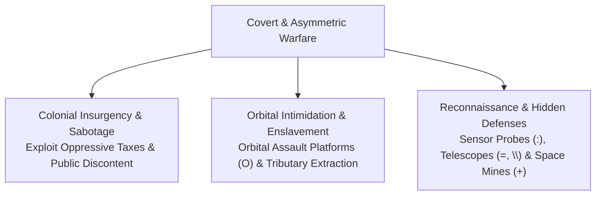
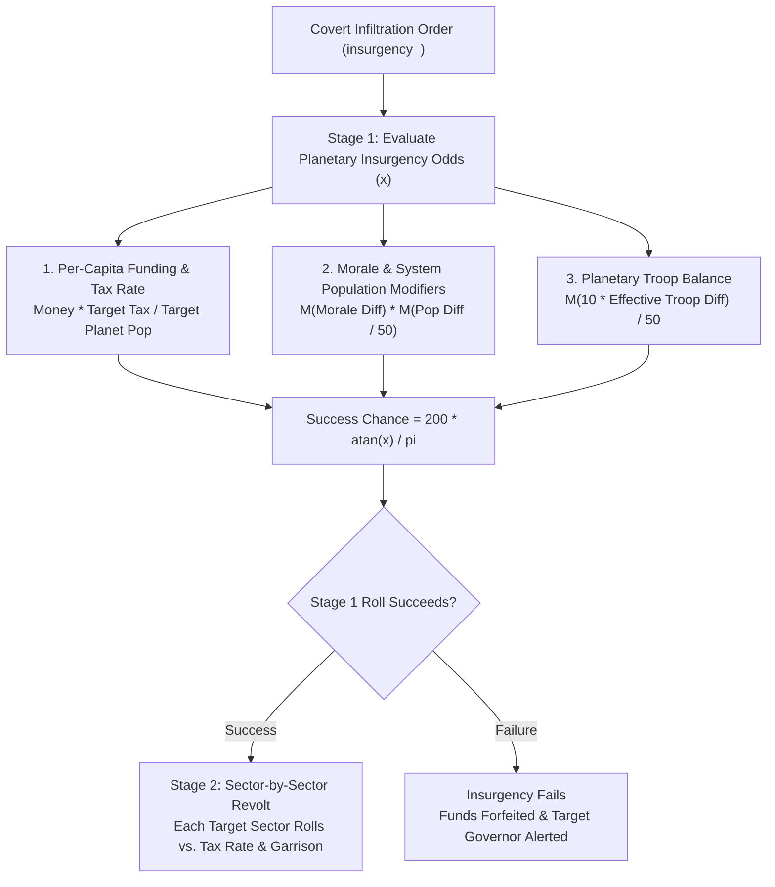
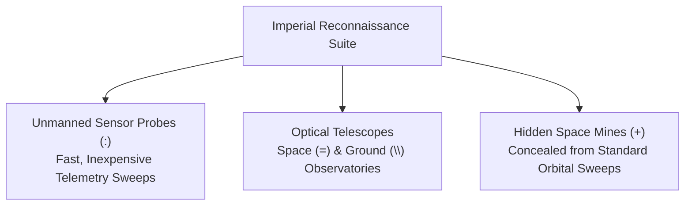

# Covert Operations, Espionage, and Insurgency

## Overview

When open warfare is too costly or politically impractical, star empires employ **Covert Operations, Subversion, and Reconnaissance**. Intelligence operatives infiltrate foreign colonies to incite civil insurrections, Orbital Assault Platforms (`O`) intimidate captive populations from orbit, and unmanned sensor probes, telescopes, and hidden space mines monitor contested borders.

---

## 1. Colonial Insurgency and Civil Rebellion

Empires can deploy covert operatives to ignite internal rebellions on enemy worlds using the `insurgency` command (`insurgency <race> <money>` at planet scope, costing $10$ Star Action Points):

### Stage 1: Planetary Insurgency Success Chance
First, the command computes raw insurgency strength $x$ using the arctangent normalization curve $`M(\Delta) = \frac{\arctan(\Delta / 10{,}000)}{\pi} + 0.5`$ and the insurgency funding factor $`K_{\text{insurg}}`$:

$$x = \left(K_{\text{insurg}} \times \frac{\text{Money} \times \text{Tax}_{\text{target}}}{\text{Pop}_{\text{target, planet}}}\right) \times \frac{M_{\text{morale}} \times M_{\text{pop}} \times M_{\text{troops}}}{50.0}$$

- **Empire Morale ($`M_{\text{morale}}`$)**: $`M(\text{Morale}_{\text{instigator}} - \text{Morale}_{\text{target}})`$.
- **Star-System Civilian Balance ($`M_{\text{pop}}`$)**: $`M\!\left(\frac{\text{Pop}_{\text{instigator, system}} - \text{Pop}_{\text{target, system}}}{50.0}\right)`$, where a $500{,}000$-civilian differential across the star system equals $\pm 10{,}000$ morale.
- **Planetary Troop Balance ($`M_{\text{troops}}`$)**: $`M\!\left(10.0 \times (\text{Fighters}_{\text{instigator}} \cdot \text{Troops}_{\text{instigator}} - \text{Fighters}_{\text{target}} \cdot \text{Troops}_{\text{target}})\right)`$, where a $1{,}000$-unit effective troop differential on the planet equals $\pm 10{,}000$ morale.
- **Odds Normalization & Percentage Conversion**: Dividing by $50.0$ normalizes $x$, and $\text{round}\!\left(\frac{200.0 \cdot \arctan(x)}{\pi}\right)\%$ maps $\arctan(x) \in [0, \pi/2)$ onto $[0\%, 100\%)$.

### Stage 2: Sector-by-Sector Uprising
When the Stage 1 roll succeeds, each populated sector owned by the target empire is evaluated individually:
- **Taxation Grievances**: Each populated sector rolls against the target governor's active planetary tax rate ($\text{Tax}\%$). Higher tax rates directly increase the probability of a sector joining the uprising.
- **Garrison Suppression Formula**: When a sector's population attempts to revolt, a random uprising roll $R \in [1, \text{Population}]$ is compared against the defending garrison's suppression threshold:

$$\text{Suppression Threshold} = 10 \times \text{Fighters}_{\text{race}} \times \text{Troops}_{\text{sector}}$$

  If $R \le \text{Suppression Threshold}$, the stationed troops crush the uprising in that sector; if $R > \text{Suppression Threshold}$, the sector successfully revolts.

### Consequences of a Successful Insurgency
1. **Sector Defection & Tax Inheritance**: Every revolting sector immediately transfers ownership to the instigating empire, and the instigator inherits the target's planetary tax rate.
2. **Garrison Elimination**: All defending military troops ($`\text{Troops}_{\text{sector}}`$) stationed in each revolting sector are wiped out.
3. **Civilian Casualties & Demographic Sync**: Street fighting inflicts random civilian casualties between $0$ and $\text{Population} - 1$, and planetary civilian, military, sector ownership, and mobilization totals are immediately reconciled across both empires.

---

## 2. Orbital Intimidation and Planetary Enslavement

Rather than wiping out productive colonies through orbital bombardment, an empire with an active **Orbital Assault Platform (`O`)** in planetary orbit can subjugate the world using `enslave <ship>` (see [Planetary Mechanics](planets.md)):
- **Tributary Diversion**: While enslaved, the planet's turn-update resource, fuel, destruct, and tax outputs are diverted to the enslaving empire's orbital fleet.
- **Revolt Suppression**: Maintaining an undamaged, active Orbital Assault Platform in orbit gives a $50\%$ chance to suppress triggered slave revolts and gives each master-owned surface sector a $50\%$ chance to survive if a revolt erupts.
- *Unimplemented Prototype Note*: Although the ship catalog lists **Mind Control Lasers (`l`)**, that hull class is an unimplemented 1989 design stub and cannot be constructed.

---

## 3. Reconnaissance, Hidden Mines, and Sensor Limits

Information superiority is the foundation of covert strategy:

- **Sensor Probes (`:`)**: Fast, automated reconnaissance vehicles built on planets, in Habitats, or inside warship hangars to scout distant star systems.
- **Space and Ground Telescopes (`=`, `\\`)**: Long-range astronomical observatories (`=` in orbit, `\\` on planetary surfaces) whose sighting range scales with technology to survey neighboring stars without crossing borders.
- **Hidden Space Mines (`+`)**: Foreign Space Mines remain concealed from standard orbital maps until explicitly sighted, allowing covert perimeter denial around key worlds. *(Note: the $999.0$-tech **Cloaking Device** discovery milestone is a reserved 1989 stub with no constructible cloaked ship classes.)*

---

## See Also
- [Diplomacy, Coalitions, and Power Blocks](diplomacy.md)
- [Imperial Economy, Planetary Stockpiles, and Technology Investment](economy.md)
- [Governance, Capitals, and Imperial Administration](governance.md)
- [Tactical Combat, Naval Gunnery, and Planetary Warfare](combat.md)
- [Autonomous Machine AI, Von Neumann Probes, and Berserker Warships](von_neumann.md)
- [Starships, Orbital Hierarchies, and Naval Mechanics](ships.md)
