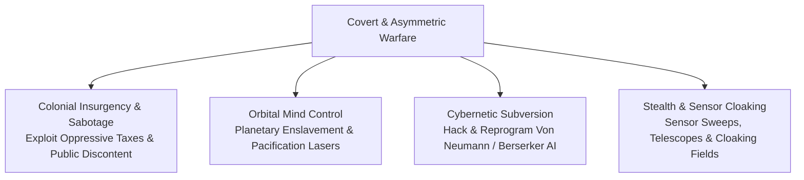
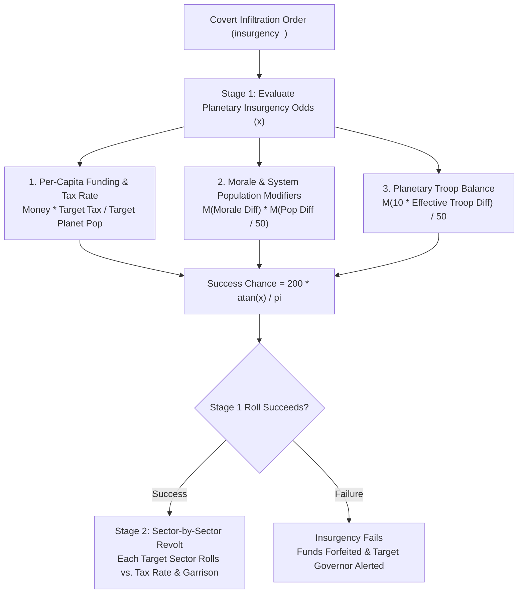
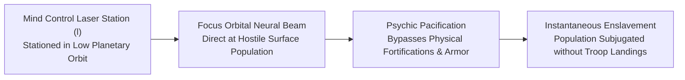
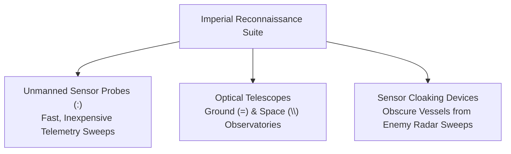

# Covert Operations, Espionage, and Insurgency

## Overview

When open warfare is too costly or politically impractical, star empires employ **Covert Operations, Espionage, and Asymmetric Subversion**. Intelligence operatives infiltrate foreign colonies to incite civil insurrections, orbital mind-control beams pacify hostile populations from orbit, cybernetic hackers reprogram autonomous machine minds, and cloaked sensor probes map enemy territory from deep space.

---

## 1. Colonial Insurgency and Civil Rebellion

Empires can deploy covert operatives to ignite internal rebellions on enemy worlds using the `insurgency` command (`insurgency <race> <money>` at planet scope, costing $10$ Star Action Points):

### Stage 1: Planetary Insurgency Success Chance
First, the command computes raw insurgency strength $x$ using the arctangent normalization curve $`M(\Delta) = \frac{\arctan(\Delta / 10{,}000)}{\pi} + 0.5`$ and the insurgency funding factor $`K_{\text{insurg}}`$:

$$x = \left(K_{\text{insurg}} \times \frac{\text{Money} \times \text{Tax}_{\text{target}}}{\text{Pop}_{\text{target, planet}}}\right) \times \frac{M_{\text{morale}} \times M_{\text{pop}} \times M_{\text{troops}}}{50.0}$$

- **Empire Morale ($`M_{\text{morale}}`$)**: $`M(\text{Morale}_{\text{instigator}} - \text{Morale}_{\text{target}})`$.
- **Star-System Civilian Balance ($`M_{\text{pop}}`$)**: $`M\!\left(\frac{\text{Pop}_{\text{instigator, system}} - \text{Pop}_{\text{target, system}}}{50.0}\right)`$, where a $500{,}000$-civilian differential across the star system equals $\pm 10{,}000$ morale.
- **Planetary Troop Balance ($`M_{\text{troops}}`$)**: $`M\!\left(10.0 \times (\text{Fighters}_{\text{instigator}} \cdot \text{Troops}_{\text{instigator}} - \text{Fighters}_{\text{target}} \cdot \text{Troops}_{\text{target}})\right)`$, where a $1{,}000$-unit effective troop differential on the planet equals $\pm 10{,}000$ morale.
- **Odds Normalization & Percentage Conversion**: Dividing by $50.0$ normalizes $x$, and $\operatorname{round}\!\left(\frac{200.0 \cdot \arctan(x)}{\pi}\right)\%$ maps $\arctan(x) \in [0, \pi/2)$ onto $[0\%, 100\%)$.

### Stage 2: Sector-by-Sector Uprising
When the Stage 1 roll succeeds, each populated sector owned by the target empire is evaluated individually:
- **Taxation Grievances**: Each populated sector rolls against the target governor's active planetary tax rate ($\text{Tax}\%$). Higher tax rates directly increase the probability of a sector joining the uprising.
- **Garrison Suppression Formula**: When a sector's population attempts to revolt, a random uprising roll $R \in [1, \text{Population}]$ is compared against the defending garrison's suppression threshold:

$$\text{Suppression Threshold} = 10 \times \text{Fighters}_{\text{race}} \times \text{Troops}_{\text{sector}}$$

  If $R \le \text{Suppression Threshold}$, the stationed troops crush the uprising in that sector; if $R > \text{Suppression Threshold}$, the sector successfully revolts.

### Consequences of a Successful Insurgency
1. **Sector Defection & Tax Inheritance**: Every revolting sector immediately transfers ownership to the instigating empire, and the instigator inherits the target's planetary tax rate.
2. **Garrison Elimination**: All defending military troops ($`\text{Troops}_{\text{sector}}`$) stationed in each revolting sector are wiped out.
3. **Civilian Casualties & Demographic Sync**: Street fighting inflicts random civilian casualties between $0$ and $\text{Population} - 1$, and planetary civilian, military, sector ownership, and mobilization totals are immediately reconciled across both empires.

---

## 2. Orbital Mind Control and Population Pacification

Advanced scientific empires (requiring **Technology Level $350.0+$**) can construct **Mind Control Laser Platforms (`l`)**:

- **Orbital Neural Projection**: Stationed in low planetary orbit, the platform projects focused psionic beams through the upper atmosphere.
- **Bloodless Subjugation**: Bypasses fortified surface bunkers, defense gun batteries, and ground troops, directly pacifying native colonists and forcing the population into imperial servitude (`enslave`).

---

## 3. Cybernetic Subversion and Machine AI Hacking

Autonomous Von Neumann machines and Berserkers operating across the galaxy can be intercepted and subverted:

- **Mind Reprogramming**: Specialist cyber-warfare teams can capture landed probes or orbital Berserkers and tamper with their core neural matrices.
- **Mission Redirection**: Hackers can overwrite the machine's ancestral progenitor ID, wipe out its target aggression hitlists, or reprogram Berserker battlefleets to hunt down enemy star systems.

---

## 4. Stealth Reconnaissance and Sensor Cloaking

Information superiority is the foundation of covert strategy:

- **Sensor Probes (`:`)**: Fast, automated reconnaissance vehicles built inside warship hangars. Probes scout uncharted star systems, mapping planetary compositions and detecting hidden enemy installations.
- **Space and Ground Telescopes (`=`, `\\`)**: Long-range astronomical observatories that peer across deep space to survey distant star systems without crossing hostile borders.
- **Sensor Cloaking Fields ($999.0\text{ Tech}$)**: Advanced electromagnetic cloaking devices that render capital ships invisible to standard orbital sensor sweeps, allowing surprise fleet deployments and covert strikes.

---

## See Also
- [Diplomacy, Coalitions, and Power Blocks](diplomacy.md)
- [Imperial Economy, Planetary Stockpiles, and Technology Investment](economy.md)
- [Governance, Capitals, and Imperial Administration](governance.md)
- [Tactical Combat, Naval Gunnery, and Planetary Warfare](combat.md)
- [Autonomous Machine AI, Von Neumann Probes, and Berserker Warships](von_neumann.md)
- [Starships, Orbital Hierarchies, and Naval Mechanics](ships.md)
