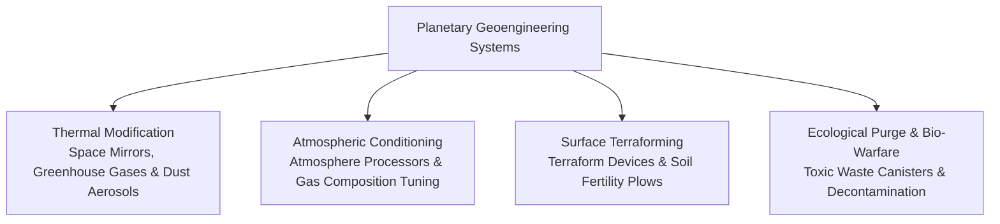
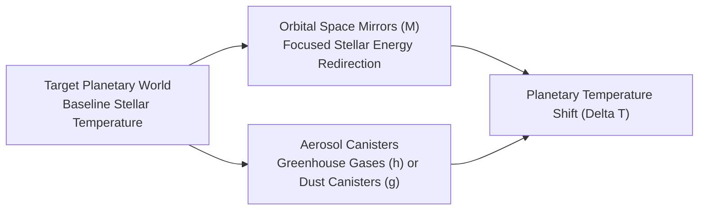
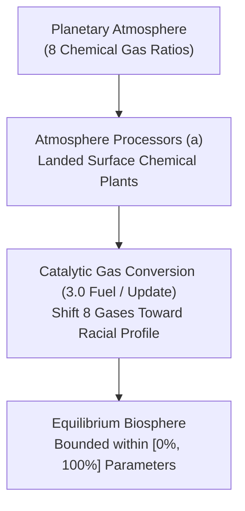
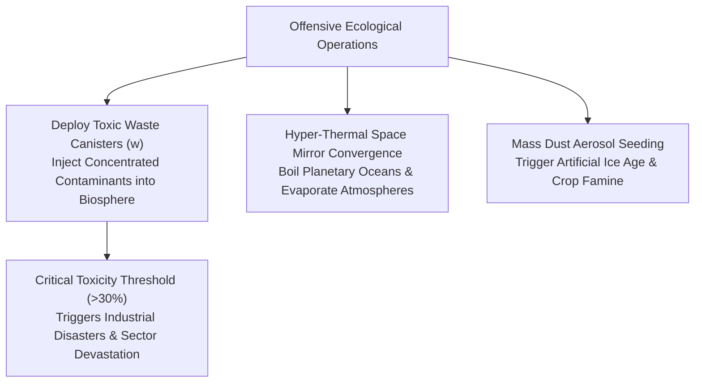

# Geoengineering, Terraforming, and Ecological Warfare

## Overview

In **Galactic Bloodshed**, worlds vary from paradisiacal Earth-like biospheres to scorched volcanic hellscapes, frozen methane wastes, and radioactive ruins. Through advanced **Geoengineering and Terraforming**, empires alter planetary climates, adjust atmospheric gas compositions, melt glaciers, restore agricultural fertility, and purge industrial toxicity to convert barren worlds into thriving colonies.

Conversely, these same environmental technologies can be weaponized as instruments of **Ecological Warfare**, destabilizing enemy biospheres through runaway greenhouse heating, artificial nuclear winters, or toxic contamination.

---

## 1. Thermal Modification and Climate Engineering

Planetary surface temperatures can be shifted toward species-compatible equilibrium through orbital mirrors and atmospheric aerosols:

### Orbital Space Mirrors (`M`)
Space Mirrors are massive orbital reflector arrays designed to capture and redirect stellar radiation within their star system:
- **Planetary Heating**: Aimed directly at a planet in the same star system (`order <ship> aim <planet>`, `order <ship> intensity <0..100>`), mirrors focus concentrated solar energy into the upper atmosphere to warm surface temperatures and melt ice sheets (cooling requires dust canisters `g`).
- **Thermal Redirection Formula**: Within planetary orbit range ($\text{Range} \le 50$), effective intensity equals $\text{Intensity}$; beyond $\text{Range} > 50$, $`I_{\text{effective}} = \lfloor 50 \times \text{Intensity} / \text{Range} \rfloor`$. Accounting for hull damage, $`\Delta T = \text{round}\!\left((1 - 0.01 \times \text{Damage}) \times I_{\text{effective}}\right)`$.

### Atmospheric Aerosol Canisters
- **Greenhouse Gas Canisters (`h`)**: Injected into the troposphere to trap infrared radiation, raising global planetary temperatures.
- **Dust Canister Aerosols (`g`)**: Dispersed into the stratosphere to create artificial cloud cover, reflecting incoming sunlight and lowering global temperatures to counteract runaway greenhouse effects.

---

## 2. Atmospheric Processing and Gas Composition

Planetary atmospheres consist of eight distinct chemical gas concentrations (Methane, Oxygen, Carbon Dioxide, Hydrogen, Nitrogen, Sulfur, Helium, and Other):

### Atmosphere Processors (`a`)
Atmosphere Processors are fixed industrial installations constructed on planetary sectors:
- **Catalytic Gas Synthesis**: During each **full turn update**, an active (`order on`) landed processor expends $3.0$ fuel and shifts each of the eight atmospheric gas percentages toward the owning species' ideal respiratory profile, scaled by crew complement and inverse planet size ($`50 / (50 + N_{\text{sectors}})`$).
- **Scope Boundary**: Atmosphere Processors adjust gas composition only; they **do not** scrub planetary `Toxicity` (toxicity remediation requires Toxic Waste Canisters `w`).
- **Safety Clamping**: All eight gas concentrations remain bounded within $[0\%, 100\%]$.

---

## 3. Surface Terraforming and Soil Conditioning

Transforming hostile planetary terrain into arable land is accomplished through mobile ground machinery:

### Terraform Devices (`T`)
Terraform Devices are autonomous ground vehicles programmed with sequential movement routes across the planetary grid:
- **Surface Conditioning**: As the device traverses sectors, it systematically terraforms hostile biomes (deserts, glaciers, volcanic crags) into the owning species' preferred habitat terrain classification.
- **Wasteland Reclamation**: Converts radioactive wastelands into clean, habitable landmasses.
- **Colony Reset**: Terraforming a sector completely clears any existing colony, resetting ownership, population, troops, sector efficiency, and mobilization to zero.

### Space Plows (`K`)
Space Plows are specialized agricultural engineering vehicles that cultivate surface topsoil along programmed ground routes:
- **Fertility Enhancement**: Expending $2.0$ fuel per update step across tolerated sectors, plows cultivate topsoil and increase agricultural fertility toward $100\%$ (up to $10$ points per update, scaled by hull efficiency and crew complement).
- **Industrial Waste Byproduct**: Continuous heavy plowing carries a chance of increasing planetary toxicity, requiring periodic environmental monitoring.

---

## 4. Ecological Warfare and Toxicity Manipulation

Environmental technologies can be deployed offensively to collapse enemy ecosystems:

### Toxic Waste Canisters (`w`)
- **Environmental Remediation**: Colonies construct canisters (`build w` or automated turn-update construction via `toxicity <threshold>`) for $10$ resources (`20` fuel capacity, cruise speed $4$) to purge up to $20$ points of toxicity from their biospheres.
- **Offensive Biological Warfare**: Canisters can be fueled and launched under their own sublight propulsion or transported aboard starships and detonated (or destroyed in orbit) at hostile worlds, spiking planetary pollution past critical safety limits.

### Environmental Disaster Thresholds
When planetary toxicity exceeds **$30\%$ Toxicity**, the world enters ecological crisis:
- Severe industrial catastrophes trigger spontaneously during turn updates.
- Random populated sectors are atomically incinerated into radioactive wastelands (`%`), destroying civilian populations, wiping out ground infrastructure, and destroying resource veins.

---

## See Also
- [Planetary Mechanics, Colonization, and Surface Topography](planets.md)
- [Planetary Simulation Engine and Sector Dynamics](planetary_simulation.md)
- [Species Biology, Ecology, and Racial Genetics](races.md)
- [Ship Classes and Construction Catalog](ship_types.md)
- [Tactical Combat, Naval Gunnery, and Planetary Warfare](combat.md)
- [Turn Simulation Lifecycle and Scheduling](turn_cycle.md)
