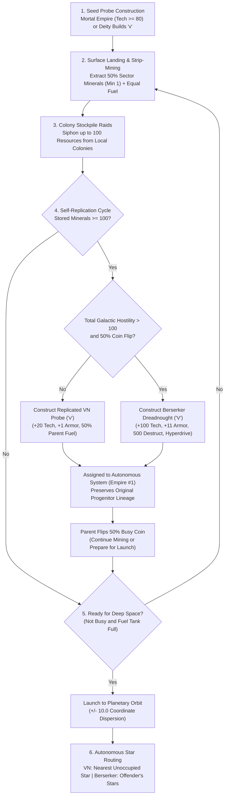

# Autonomous Machine AI, Von Neumann Probes, and Berserker Warships

## Overview

**Von Neumann Machines (`v`)** and **Berserkers (`V`)** are autonomous, self-replicating robotic intelligences in **Galactic Bloodshed**. Deployed across deep space as self-sustaining exploration and mining probes, these machine entities travel between star systems, land on mineral-rich worlds, strip-mine planetary biospheres, raid colony stockpiles, synthesize propellants and munitions, and replicate exponentially.

When threatened or destroyed by spacefaring empires, the collective machine network logs the aggression and mobilizes for war, manufacturing heavily armored Berserker dreadnoughts programmed to hunt down and bombard the star systems of hostile civilizations.

---

## 1. Construction, Ownership, and Cybernetic Lineage

### Seed Construction vs. Berserker Restriction
- **Von Neumann Probes (`v`)**: Any mortal empire that reaches the Von Neumann technology threshold ($80.0$ engineering technology) and discovers Von Neumann technology can construct a generation-1 seed probe on a planetary sector ($100$ resources, base armor $1$, speed $4$, $0$ crew, $20$ resource capacity, $50$ fuel capacity).
- **Berserker Warships (`V`)**: Berserkers have a base technology rating of $999.0$ and are restricted to Deity creation or autonomous machine war mobilization. Mortal empires can never directly build or factory-program a Berserker hull.

### Ownership vs. Progenitor Lineage
Autonomous machines maintain a strict separation between **operational ownership** and **ancestral progenitor lineage**:

| Lifecycle Stage | Operational Owner | Progenitor Identity | Strategic & Scoring Implications |
| :--- | :--- | :--- | :--- |
| **Generation-1 Seed Probe (`build v`)** | Constructing Empire | Constructing Empire | Owned by the builder, but completely autonomous (cannot be steered, unloaded, or boarded). |
| **Replicated VN Offspring (`v`)** | Autonomous System (Empire #1) | Inherited from Parent | Operates as an independent rogue machine; does not count toward the mortal progenitor's ship count, power rating, or victory score. |
| **Replicated Berserker (`V`)** | Autonomous System (Empire #1) | Inherited from Parent | Prevents mortal empires from commanding, disarming, or unloading God-tier Berserker dreadnoughts, and ensures Berserkers do not spare their mortal progenitor's colonies during orbital bombardment. |

Whenever a generation-1 seed probe owned by a mortal empire spawns a Berserker directly, the parent machine transmits an automated construction telegram to the mortal owner announcing the new Berserker's designation before the offspring enters autonomous System control.

### Command, Logistics, and Combat Immunities
Even when an empire owns a generation-1 Von Neumann probe, the machine's autonomous AI enforces strict operational immunities:
- **No Manual Navigation**: Von Neumann probes reject manual navigation orders (`order`); their destinations and throttle settings are governed exclusively by internal machine logic.
- **No Cargo Unloading**: Players cannot unload minerals or propellant from a Von Neumann machine (`unload` is rejected).
- **Boarding & Capture Immunity**: Because Von Neumann probes are solid-state robotic chassis with zero crew compartments ($`\text{Max Crew} = 0`$), they cannot be boarded in space (`assault`) or captured on planetary surfaces (`capture`).
- **Morale Neutrality**: Destroying a Von Neumann probe in combat neither awards morale to the attacker nor inflicts a morale penalty on the machine's owner.

### Generational Hardware Evolution
Each autonomous machine carries an internal cybernetic mind tracking its lineage and mission state:
- **Progenitor**: The ancestral empire that constructed the generation-1 seed machine.
- **Generational Counter**: Starts at $`g = 1`$ for newly built probes. Every replicated Von Neumann probe increments the generation counter ($`g_{\text{child}} = g_{\text{parent}} + 1`$), whereas a newly mobilized Berserker retains its parent's current generation number ($`g_{\text{child}} = g_{\text{parent}}`$).
- **Iterative Hardware Upgrades**:
  - **Replicated Von Neumann Probe**: $`\text{Tech}_{\text{child}} = \text{Tech}_{\text{parent}} + 20.0`$ and $`\text{Armor}_{\text{child}} = \text{Armor}_{\text{parent}} + 1`$.
  - **Replicated Berserker Warship**: $`\text{Tech}_{\text{child}} = \text{Tech}_{\text{parent}} + 100.0`$ and $`\text{Armor}_{\text{child}} = \text{Armor}_{\text{parent}} + 11`$.
- **Binary Designations**: Replicated Von Neumann probes assign themselves random binary hull names between $3$ and $10$ bits in length (e.g. `"1010011"`, `"01101"`).

---

## 2. Planetary Surface Operations and Strip-Mining

### Orbital Arrival and Landing Site Selection
When an active, busy machine arrives in planetary orbit around its target world during the planetary simulation phase:
- **Gas Giant Avoidance**: If the target planet is a Gas Giant, the machine aborts landing and clears its busy assignment (allowing it to skim atmospheric fuel in orbit).
- **Resource Sector Scan**: On terrestrial worlds, the machine scans all surface sectors in random order and lands on the first sector containing positive mineral deposits ($`\text{Sector Minerals} > 0`$), setting its mission state to **busy**. If the entire planet is devoid of mineral resources, the machine clears its busy flag without landing.

### Sector Strip-Mining and Onboard Synthesis
During each planetary update pass, a landed, busy Von Neumann probe strip-mines its current sector:

$$\text{Extracted Yield} = \max\Big(1,\; \text{Sector Minerals} - \lfloor 0.5 \times \text{Sector Minerals} \rfloor\Big)$$

- **Guaranteed Depletion**: At least $1$ mineral unit is always extracted when a sector has positive reserves, preventing infinite mining loops on trace deposits ($1$ resource remaining).
- **Cargo & Propellant Synthesis**:
  - **Von Neumann Probe (`v`)**: Adds $\text{Extracted Yield}$ to its onboard **mineral cargo** (clamped to its $20$-unit cargo capacity, or higher if modified) and adds an equal amount ($\text{Extracted Yield}$) to its **fuel tank**.
  - **Berserker (`V`)**: Converts extracted minerals into $5 \times \text{Extracted Yield}$ **destruct ordnance** and adds $\text{Extracted Yield}$ to its **fuel tank**.
- **Sector Depletion and Toroidal Roaming**: If the occupied sector's mineral reserves have reached $0$, the probe instead roams to a random adjacent sector (wrapping seamlessly across the planet's east/west longitudinal seam while respecting north/south polar boundaries).

### Colony Stockpile Raids
During the naval simulation phase, any landed machine that does not launch into orbit raids local planetary stockpiles:
- The machine shuffles all empires in the galaxy and selects the first empire that owns at least one surface sector on the planet.
- It siphons up to the Von Neumann base construction cost ($100$ resources) directly from that victim's planetary resource stockpile:

$$\text{Stolen Resources} = \min\Big(\text{Victim Planetary Resources},\; 100\Big)$$

- **Von Neumann Probes (`v`)** store the stolen minerals in their **resource cargo bay** to fuel self-replication.
- **Berserkers (`V`)** convert the stolen minerals $1:1$ into **destruct ammo**.
- An automated theft bulletin telegram is dispatched to the victim empire (and to the machine's owner if distinct from the victim).

---

## 3. Self-Replication and Launch Lifecycle

### Replication Cycle
Immediately after mining or roaming during the planetary simulation phase, a landed, busy Von Neumann probe checks whether its accumulated mineral cargo can fund offspring construction ($100$ resources for both Von Neumann probes and Berserkers):

$$\text{Offspring Count} = \left\lfloor \frac{\text{Stored Minerals}}{100} \right\rfloor$$

For each offspring constructed in the batch:
1. **Mineral Expenditure**: $100$ resources are deducted from the parent's cargo hold.
2. **Propellant Division**:
   - **Von Neumann Offspring (`v`)**: Receives $50\%$ of the parent's current fuel ($`\text{Fuel}_{\text{child}} = 0.5 \times \text{Fuel}_{\text{parent}}`$), and the parent's fuel is reduced by $50\%$.
   - **Berserker Offspring (`V`)**: Receives $5 \times \text{Fuel}_{\text{parent}}$ (clamped to the Berserker's $1,000$-unit fuel capacity), and the parent's fuel is reduced by $50\%$.
3. **Initial Deployment State**: The newborn machine is placed on the same planetary sector as its parent with its busy flag set to **false** (`idle`), waiting to top off its fuel tanks and launch.
4. **Parent Busy Coin Flip**: After each offspring is built, the parent machine flips a fair $50/50$ coin to set its own busy state:
   - **Heads (`busy = true`)**: The parent remains assigned to surface strip-mining on the planet.
   - **Tails (`busy = false`)**: The parent completes its surface assignment and prepares to launch into deep space once its fuel tanks are full.

### Deep Space Launch Conditions
During the naval simulation phase, a landed machine launches into planetary orbit if and only if **both** conditions hold:
1. **Unassigned (`busy = false`)**: The machine is either a newly replicated offspring or a parent whose post-replication coin flip ended its surface mining tour.
2. **Full Fuel Tanks**: The machine's onboard fuel is at maximum capacity (within $10^{-4}$ units).

Upon launch, the machine is placed into planetary orbit with a random spatial dispersion offset $(\Delta x, \Delta y) \in [-10.0, 10.0] \times [-10.0, 10.0]$ around the planet's coordinates so sibling machines do not stack at identical coordinates.

---

## 4. Galactic Hostility, Retaliation Memory, and Berserker Warfare

### Global Kill Tracking and Two-Star Retaliation Memory
Whenever any empire destroys a Von Neumann probe or Berserker warship (in ship-to-ship combat, planetary defense fire, or scuttling), the Universe retaliation registry records the attack against the offending empire:
- **Hit Counter Increment**: The killer empire's cumulative VN hit counter increases by $1$ ($`\text{Hits}_{\text{killer}} \leftarrow \text{Hits}_{\text{killer}} + 1`$).
- **Two-Slot Star Memory**: If the machine was destroyed inside a star system, that star ID is recorded in the killer's two-slot retaliation record (`Primary Star` and `Secondary Star`):
  1. If `Primary Star` is empty, the star is stored in `Primary Star`.
  2. Otherwise, if `Secondary Star` is empty, the star is stored in `Secondary Star`.
  3. Once both slots are populated, each subsequent kill has a $50\%$ chance of overwriting `Primary Star` and a $50\%$ chance of overwriting `Secondary Star`.

### War Mobilization Threshold
At the start of each full turn update, the collective machine intelligence evaluates global hostility across all empires:

$$\text{Total Galactic Hostility} = \sum_{p} \text{Hits}_{p}, \qquad \text{Primary Aggressor} = \arg\max_{p,\, \text{Hits}_{p} > 0} \text{Hits}_{p}$$

When $\text{Total Galactic Hostility} > 100$, all landed Von Neumann probes enter **war mobilization**: each replication cycle has a **$50\%$ probability** of producing a **Berserker Warship (`V`)** instead of a standard probe (`v`).

### Berserker Warship Specifications

| Subsystem / Metric | Specification | Tactical Capabilities |
| :--- | :--- | :--- |
| **Hull & Guns** | $40$ Heavy Primary Guns | High-caliber spinal battery with automated defensive retaliation enabled. |
| **Armor Plating** | $`\text{Armor}_{\text{parent}} + 11`$ (Base $15$) | Capital-grade armor plating resistant to conventional fleet fire. |
| **Technology Level** | $`\text{Tech}_{\text{parent}} + 100.0`$ | Massive technological leap over parent probe. |
| **Destructive Munitions** | $500$ Destruct Ammo | Fully loaded munitions magazine for orbital bombardment and naval combat. |
| **Propulsion & Hyperdrive** | Speed $6$, Crystal-Mounted Hyperdrive | Pre-charged hyperdrive ready for immediate interstellar jump. |
| **Crew Staffing Exemption** | $0$ Crew Required | Fires all $40$ heavy guns and repairs hull damage without living crew. |

### Autonomous Star Routing
When an unlanded, busy machine selects its next interstellar destination during the naval phase:
- **Von Neumann Probes (`v`)**:
  1. Compute the **closest** and **second-closest** star systems to the probe's current coordinates (excluding its current star system).
  2. If the closest star system is not already marked as inhabited by the autonomous System (`Empire #1`), target a random planet in the closest star system.
  3. Otherwise, if the second-closest star system is not inhabited by `Empire #1`, target a random planet in the second-closest star system.
  4. If both nearest stars are already occupied by `Empire #1`, select a random star system in the galaxy and target a random planet within it.
- **Berserker Warships (`V`)**:
  1. Lock onto the galaxy's **Primary Aggressor** and flip a $50/50$ coin between that empire's recorded `Primary Star` and `Secondary Star` (falling back to the other slot if only one is recorded, or to a random star system in the galaxy if no star is recorded).
  2. Target a random planet in the selected star system, arm orbital bombardment, and engage the pre-charged crystal hyperdrive.

### Orbital Bombardment, PDN Deterrence, and Vendetta Decay
During the planetary simulation phase, a Berserker in planetary orbit with stored destruct ammo ($\text{Destruct} > 0$) and active bombardment orders executes an orbital strike against its target planet:
1. **Planetary Defense Network (PDN) Deterrence**: If any operational PDN belonging to another empire is present on the planet, the Berserker cancels its bombardment run and dispatches a deterrence notice.
2. **Sector Targeting Priority**:
   - **Priority 1**: Surface sectors owned by an empire at war with the Berserker's owner, or owned by the Berserker's programmed target empire.
   - **Priority 2**: Any other surface sector owned by a foreign empire.
3. **Strike Execution & Retargeting**:
   - The Berserker fires with strength:

$$\text{Strike Power} = \min\left(\left\lfloor 40 \times \frac{100 - \text{Damage}}{100} \right\rfloor,\; \text{Stored Destruct}\right)$$

   - If $0$ sectors are destroyed (e.g., no valid target sectors exist or ground fire absorbs the strike), the Berserker immediately retargets a new random planet in the same star system.
4. **Vendetta Decay**: Whenever a Berserker's bombardment successfully destroys at least $1$ planetary sector and the Berserker carries a recorded offender ID from its lineage, the Universe retaliation registry **decrements** that offender's hit count by $1$:

$$\text{Hits}_{\text{offender}} \leftarrow \max\Big(0,\; \text{Hits}_{\text{offender}} - 1\Big)$$

   Each successful retaliatory bombardment partially satisfies the machine network's vendetta, allowing galactic hostility to subside once sufficient destruction has been inflicted.

---

## See Also
- [Starships, Orbital Hierarchies, and Naval Mechanics](ships.md)
- [Ship Classes and Construction Catalog](ship_types.md)
- [Tactical Combat, Naval Gunnery, and Planetary Warfare](combat.md)
- [Covert Operations, Espionage, and Insurgency](covert_ops.md)
- [Planetary Mechanics, Colonization, and Surface Topography](planets.md)
- [Planetary Simulation Engine and Sector Dynamics](planetary_simulation.md)
- [Governance, Capitals, and Imperial Administration](governance.md)
- [Imperial Economy, Planetary Stockpiles, and Technology Investment](economy.md)
- [Turn Simulation Lifecycle and Scheduling](turn_cycle.md)
